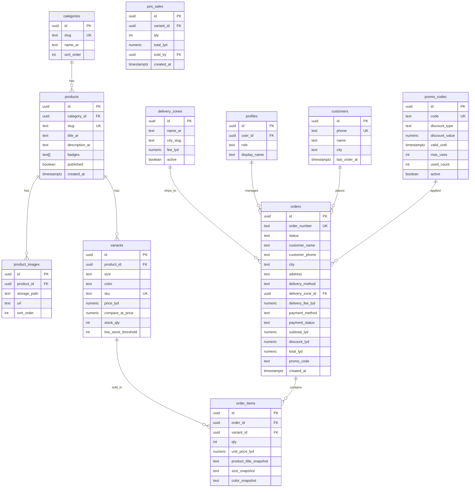

# AZIZA Boutique — نموذج البيانات (ERD)

## مخطط العلاقات

## حالات الطلب

| `status` | الوصف |
|----------|--------|
| `new` | جديد |
| `confirmed` | مؤكد |
| `preparing` | قيد التجهيز |
| `out_for_delivery` | خرج للتوصيل |
| `delivered` | سُلّم |
| `cancelled` | ملغى |

## شارات المنتج (`badges`)

`new`, `last_piece`, `sold_out`, `sale`

## تدفق الطلب المعتمد

**حفظ الطلب في النظام ثم فتح واتساب برسالة جاهزة** — يضمن رقم تتبع ومخزوناً دقيقاً مع بقاء واتساب قناة البيع.
