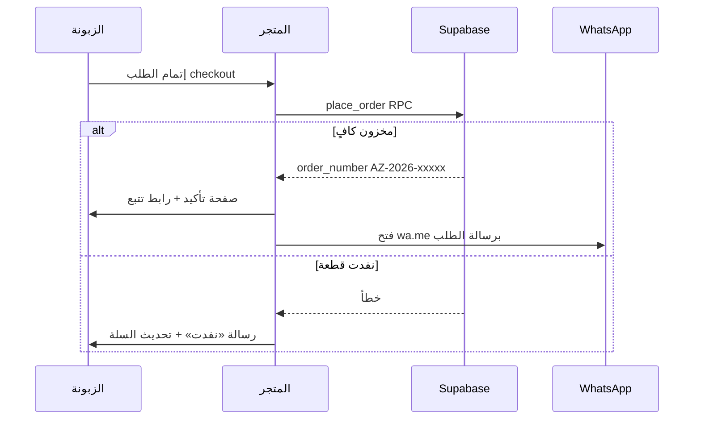

# تدفق الطلب — قرار معتمد

## MVP (منتج واحد)

1. الزبونة تختار مقاس/لون في صفحة المنتج.
2. تضغط **«اطلبي عبر واتساب»**.
3. يفتح `wa.me` برسالة تحتوي: اسم المنتج، المقاس، اللون، السعر، رابط الصفحة.
4. لا يُخصم مخزون حتى المرحلة 2.

## المرحلة 2+ (سلة)

## تحديث الحالة (نصف آلي)

1. المالك يغيّر الحالة من `/admin/orders/:id`.
2. زر **«إرسال تحديث واتساب»** يفتح محادثة برسالة قالب مع رقم الطلب والحالة الجديدة.
3. (اختياري لاحقاً) Edge Function + WhatsApp Cloud API.

## رقم الطلب

صيغة: `AZ-{YEAR}-{5-digit}` — يُولَّد في PostgreSQL عند `place_order`.
